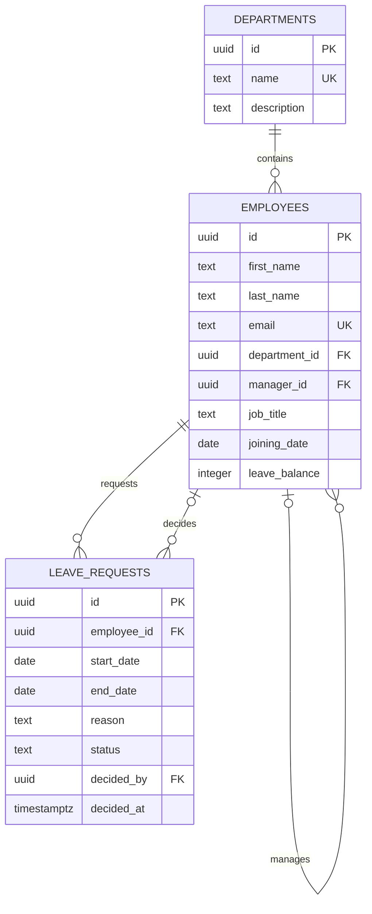

# Entity relationship diagram

`employees.manager_id` is a nullable self-reference, allowing top-level employees to have no manager. Department deletion is restricted while employees reference that department. A leave request is owned by one employee and may record the manager who decided it.
